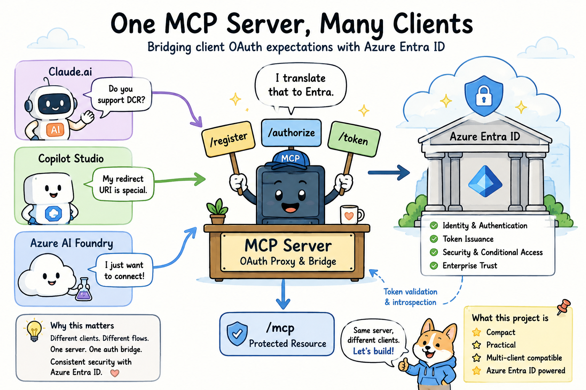
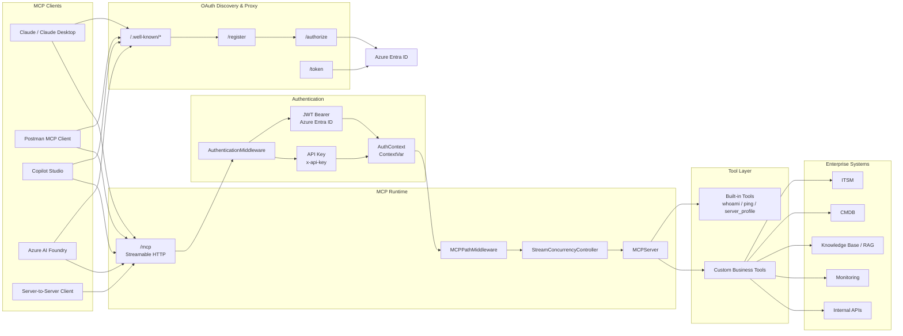

# Practical MCP Server Boilerplate for Azure Entra Integration

A compact, domain-neutral Python template for experimenting with Model Context Protocol (MCP) servers that use FastAPI, the MCP Python SDK 2.x (`MCPServer`), Azure Entra ID integration, API-key fallback, health checks, Docker packaging, and client setup notes.

This project is designed for builders who want a small, readable starting point for moving beyond a local MCP demo while still being able to replace the sample tools with their own business or IT workflows.

## Why This Exists

Most MCP examples are intentionally tiny. That is great for learning the protocol, but less helpful when you need to expose a server over HTTP, support OAuth discovery, keep API-key access for automation, and explain the deployment shape to another engineer.

Microsoft also provides more complete Azure-hosted MCP samples. This repository takes a narrower approach: it is a lightweight boilerplate meant to be easy to read, fork, and adapt.

This boilerplate packages those practical pieces into a small template:

- MCP Python SDK 2.x (`MCPServer`) tool definitions with FastAPI HTTP hosting
- Azure Entra ID integration through a lightweight OAuth proxy
- API key authentication for local development and automation
- OAuth discovery endpoints for MCP-capable clients
- Streamable HTTP mounting with path normalization
- Health and runtime metrics endpoint
- Docker and Compose support
- Integration docs with screenshots for popular clients
- Tests and GitHub Actions CI so forks start with a quality bar

## Multi-Client Authentication Concept

The same MCP server can behave differently depending on the client connecting to it.

Claude, Postman, Copilot Studio, and Azure AI Foundry each have slightly different expectations around OAuth discovery, registration, redirect handling, token flow, and resource binding.

This repository experiments with a lightweight OAuth compatibility layer that bridges those client expectations with Azure Entra ID.

> Conceptual illustration only — simplified for readability.



This diagram intentionally simplifies the flow to highlight the client-compatibility problem rather than the full OAuth protocol details.

## How This Differs from Azure's Official Sample

Microsoft provides [Azure-Samples/remote-mcp-webapp-python-auth-oauth](https://github.com/Azure-Samples/remote-mcp-webapp-python-auth-oauth), a full FastAPI MCP Weather Server sample with OAuth 2.1, PKCE, Dynamic Client Registration, Azure AD integration, a web test interface, and Azure App Service deployment through `azd`.

This repository is intentionally smaller and more domain-neutral. It is not trying to replace the Azure sample. Instead, it focuses on a reusable boilerplate shape:

| Area | Azure official sample | This repository |
|---|---|---|
| Primary goal | Full Azure-hosted sample application | Compact boilerplate / starter template |
| Domain | Weather tools | Domain-neutral starter tools |
| Deployment focus | Azure App Service with `azd` | Local-first Docker / Compose, adaptable deployment shape |
| Auth focus | Full OAuth 2.1 sample flow with PKCE and DCR | Azure Entra OAuth proxy bridge plus resource-server request validation |
| Tooling | Built-in web OAuth test interface | Minimal runtime with system design and client integration notes |
| Best for | Learning and deploying the official Azure sample app | Forking into your own MCP server PoC or business-tool template |

## Azure Entra ID and OAuth Proxy Scope

The official MCP SDK examples are the best place to learn the core protocol mechanics, including OAuth flows, protected resource metadata, client registration, and token validation patterns.

This boilerplate has a narrower practical focus: integrating an MCP server with Azure Entra ID while keeping the server easy to run, package, and extend.

Some MCP-capable clients expect OAuth discovery and Dynamic Client Registration-style endpoints, while Azure Entra uses a static App Registration model. To bridge that gap, this project includes a lightweight OAuth proxy layer:

- `/.well-known/oauth-protected-resource` and `/.well-known/oauth-protected-resource/mcp` expose protected resource metadata for the MCP resource endpoint
- `/.well-known/oauth-authorization-server` exposes the local proxy authorization server metadata
- `/register` accepts client registration requests from MCP clients and maps them to the configured Azure App Registration
- `/authorize` forwards the authorization request to Azure Entra ID with the expected full `api://` scope
- `/token` exchanges authorization codes through Azure Entra ID and returns the resulting tokens to the client

The MCP server still validates incoming requests as a resource server: bearer tokens are verified as Azure Entra JWTs, and API keys remain available for local development, automation, or simple private deployments.

### OAuth Client Compatibility Notes

This template includes a few compatibility behaviors that matter for real MCP clients:

- The 401 `WWW-Authenticate` response points to `/.well-known/oauth-protected-resource/mcp`, matching the MCP endpoint path `/mcp`.
- Both `/.well-known/oauth-protected-resource` and `/.well-known/oauth-protected-resource/mcp` return the same metadata document.
- The protected resource metadata always identifies the MCP endpoint as the resource: `https://your-host.com/mcp`.
- The `/authorize` proxy removes any short-form API scope sent by a client and injects the full Azure Entra scope: `api://{AZURE_CLIENT_ID}/{REQUIRED_SCOPE}`.
- The `/token` proxy removes the incoming `resource` parameter before calling Azure Entra, because the Azure Entra v2 token endpoint rejects it.
- The `/token` proxy adds `resource: https://your-host.com/mcp` back into successful token responses so clients can associate the token with the MCP resource.

These behaviors help avoid common failures such as Postman repeatedly receiving 401 responses after login, clients requesting both short-form and full API scopes, or Azure Entra returning `AADSTS70011` for invalid scope combinations.

### Claude.ai DCR Compatibility Note

As of 2026-05-13, Anthropic's public documentation and support materials indicate that remote MCP usage has two related but different patterns:

- Claude.ai custom connectors can use OAuth-based remote MCP servers and support Dynamic Client Registration-style flows.
- Anthropic's Messages API MCP connector can accept an `authorization_token` supplied by the API caller after the caller obtains a token through its own OAuth flow.

This distinction matters for this project. The `/register`, `/authorize`, and `/token` routes are primarily included for MCP clients such as Claude.ai custom connectors that discover OAuth metadata and expect an MCP-compatible registration and authorization surface.

Azure Entra ID does not dynamically create a new App Registration for every MCP client. This project therefore maps the client-facing DCR-style flow to a preconfigured Azure App Registration:

- `/register` returns a synthetic client registration to the MCP client
- `/authorize` maps that synthetic client to the configured Azure Entra App Registration and redirects the user to Azure Entra ID
- `/token` proxies the authorization-code exchange to Azure Entra ID
- `/mcp` remains the protected MCP resource endpoint and validates the resulting bearer token

In other words, this project does not replace Azure Entra ID. It provides the MCP-facing OAuth compatibility layer that some clients expect, while delegating identity and token issuance to Azure Entra ID.

## Repository Layout

```text
.
├── template/                    # Copy this folder to start a new MCP server
│   ├── src/server.py             # MCP tools live here
│   ├── src/apps/                 # MCP Apps: example card, shared bridge, HTML
│   ├── src/http/                 # FastAPI app, OAuth proxy, middleware
│   ├── scripts/mcp_app_host/     # Mock MCP Apps host for testing app UIs
│   ├── tests/                    # Starter tests
│   ├── Dockerfile
│   ├── docker-compose.yml
│   └── pyproject.toml
├── docs/
│   ├── CLIENT_INTEGRATION.md     # Claude, Copilot Studio, Azure AI Foundry notes
│   ├── SYSTEM_DESIGN.md          # Design rationale and request flow
│   └── screenshots/              # Setup screenshots
└── README.md
```

## Quick Start

```bash
cd template
uv sync --extra dev
cp .env.example .env
python dev.py
```

Then check:

```bash
curl http://localhost:8080/health
curl http://localhost:8080/.well-known/oauth-protected-resource
curl http://localhost:8080/.well-known/oauth-protected-resource/mcp
```

For Docker:

```bash
cd template
cp .env.example .env
docker compose up --build
curl http://localhost:8080/health
```

## Configuration

| Variable | Required | Description |
|---|---:|---|
| `BASE_URL` | Yes | Public URL of this server, no trailing slash |
| `API_KEYS` | Yes | Comma-separated keys accepted by `x-api-key` auth |
| `SERVICE_NAME` | No | Display name returned by metadata endpoints |
| `SERVICE_OWNER` | No | Owner or organization name |
| `SERVICE_VERSION` | No | Version displayed by root, health, and tools |
| `AZURE_TENANT_ID` | OAuth | Azure Entra tenant ID |
| `AZURE_CLIENT_ID` | OAuth | Azure App Registration client ID |
| `REQUIRED_SCOPE` | OAuth | Scope name exposed by the App Registration, without the `api://` prefix. Default: `MCP.Access` |
| `AZURE_CLIENT_SECRET` | Optional | Server-side secret used by the OAuth proxy |
| `ENABLE_MCP_APPS` | No | Expose the example MCP App (interactive UI). Default: `true`; `false`, `0` or `no` turns it off |

Set `BASE_URL=http://localhost:8080` and leave the Azure variables blank to run in API-key-only mode.

For OAuth mode, create an Azure App Registration and expose an API scope that matches `REQUIRED_SCOPE`. For example, if `REQUIRED_SCOPE=MCP.Access`, the proxy will request:

```text
api://{AZURE_CLIENT_ID}/MCP.Access
```

Do not put real tenant IDs, client IDs, client secrets, or API keys into this repository. Keep them in `.env`, Azure App Service configuration, Key Vault, GitHub Actions secrets, or your deployment platform's secret store.

## Authentication Modes

| Scheme | Header | Best For |
|---|---|---|
| OAuth 2.0 with Azure Entra | `Authorization: Bearer {jwt}` | Claude, Postman, Copilot Studio, enterprise users |
| API key | `x-api-key: {key}` | Local development, service jobs, simple private deployments |

Public paths are intentionally limited to `/`, `/health`, `/.well-known/*`, `/docs`, `/redoc`, `/openapi.json`, `/authorize`, `/token`, and `/register`.

## Client Integration

Use this MCP endpoint:

```text
https://your-host.com/mcp
```

OAuth endpoints are discovered through:

- `/.well-known/oauth-protected-resource`
- `/.well-known/oauth-protected-resource/mcp`
- `/.well-known/oauth-authorization-server`

### Verification

After deployment, these checks should pass:

```bash
# Bare protected resource metadata should return the MCP resource URL.
curl -s https://your-host.com/.well-known/oauth-protected-resource | jq .resource

# Path-suffixed protected resource metadata should return the same MCP resource URL.
curl -s https://your-host.com/.well-known/oauth-protected-resource/mcp | jq .resource

# Unauthorized MCP requests should advertise the path-suffixed metadata URL.
curl -sv https://your-host.com/mcp 2>&1 | grep -i www-authenticate
```

Expected resource value:

```text
https://your-host.com/mcp
```

Expected `WWW-Authenticate` pattern:

```text
Bearer resource_metadata="https://your-host.com/.well-known/oauth-protected-resource/mcp"
```

For Claude and Azure client walkthroughs, see [docs/CLIENT_INTEGRATION.md](docs/CLIENT_INTEGRATION.md). For design decisions, see [docs/SYSTEM_DESIGN.md](docs/SYSTEM_DESIGN.md).

## Included MCP Tools

| Tool | Description |
|---|---|
| `whoami` | Returns JWT claims when OAuth is used, or an API-key auth message |
| `ping` | Echoes a message with a UTC timestamp |
| `server_profile` | Returns service metadata, auth mode, endpoints, and extension hints |
| `whoami_card` | Shows the signed-in identity as an interactive card (MCP App); text for clients without UI. Only listed when `ENABLE_MCP_APPS` is on |

## Add Your Own Tool

Edit `template/src/server.py`:

```python
@mcp.tool()
async def my_tool(param: str) -> dict:
    """Tool description shown to the LLM."""
    auth = get_auth()
    return {
        "input": param,
        "auth_type": auth.auth_type if auth else "unknown",
    }
```

`get_auth()` returns an `AuthContext` with:

- `auth_type`: `"bearer"` or `"api_key"`
- `user_oid`, `user_name`, `user_upn`: populated for OAuth bearer tokens

Wrap tools with `@tool_guard(depends_on=[check_entra_groups])` (from `src/deps.py`) to apply the Entra group restriction and audit logging. `tool_guard` converts any exception raised by a dependency or the tool body into a `ToolError`, because the MCP Python SDK 2.x returns only the text of a `ToolError` to the client; anything else becomes a generic "Error executing tool" message. Raise errors with wording you are happy for the caller to read.

If an MCP App needs to call your tool through the host, declare it app-callable with `@mcp.tool(meta=APP_CALLABLE_META)` (from `src.apps`). Hosts reject an app-initiated call to a tool that does not declare it, and those calls run with the user's token, so opt in only the tools an app actually needs.

> **Upgrading from SDK 1.x:** `mcp.server.fastmcp` no longer exists. Import `MCPServer` from `mcp.server.mcpserver`, and pass transport settings (`streamable_http_path`, `stateless_http`, `transport_security`) to `streamable_http_app()` instead of the constructor. See `src/server.py` and `src/http/mcp_mount.py`.

## MCP Apps

MCP Apps let a tool return an interactive UI that clients such as Claude render in a sandboxed iframe. The template ships one small example, `whoami_card`: it shows who is signed in, can call `ping` through the host, and can send a message to the chat when the user clicks a button.

```text
template/src/apps/
├── __init__.py          # imports the app modules; exports `apps`, APP_CALLABLE_META, load_app_html
├── registry.py          # the single shared `Apps()` registry every app registers on
├── app_bridge.js        # browser side: talks to the host (handshake, tool calls, theme, size, teardown)
├── loader.py            # server side: inlines app_bridge.js into an app's HTML
├── whoami_card.py       # the example's tool + ui:// resource registration
└── whoami_card.html     # the example's UI, no external resources
template/src/identity.py # caller identity data shared by `whoami` and `whoami_card`
```

### How a request flows

```text
 Host (Claude)                    Your server                     App (iframe)
      |-- tools/call whoami_card ------>|                               |
      |<-- text + structuredContent ----|  text: for the model / no-UI clients
      |                                 |  structuredContent: for the UI
      |-- resources/read ui://... ----->|                               |
      |<-- HTML with the bridge inlined-|                               |
      |------------------------- render the iframe --------------------->|
      |<-------------------- ui/initialize (handshake) -------------------|
      |-- host context (theme, fonts) --------------------------------->|
      |<-------------------- ui/notifications/initialized ----------------|
      |-- ui/notifications/tool-result (structuredContent) ------------->|  app renders
      |<-------------------- tools/call ping (user clicks Ping) ---------|
      |-- calls your server with the user's token (tool_guard applies) -|
```

### What `app_bridge.js` does

The app is an ordinary web page in a sandbox, so it cannot reach your server directly. It can only exchange JSON-RPC messages with the host through `window.parent.postMessage`. `app_bridge.js` implements that protocol once (MCP Apps / ext-apps `2026-01-26`, no npm or CDN) and exposes a single global, `McpApp`:

| Call | What it does |
|---|---|
| `McpApp.connect({ appInfo, onFail })` | Handshake: sends `ui/initialize`, applies the host's theme and fonts, then sends `ui/notifications/initialized`. The host sends nothing before that. `onFail` runs if the host does not answer (the page was opened outside an MCP Apps client). |
| `McpApp.onNotification(method, fn)` | Handle a host notification, for example `ui/notifications/tool-result` (carries the tool's `structuredContent`), `tool-input` or `tool-cancelled`. |
| `McpApp.onRequest(method, fn)` | Answer a request from the host; return the result value. |
| `McpApp.onTeardown(fn)` | Register cleanup (stop timers, ignore late results). The bridge replies `{}` to `ui/resource-teardown` after running these. |
| `McpApp.callTool(name, args)` | `tools/call` through the host. Throws the error text if the tool failed; otherwise returns `structuredContent` (unwrapping a lone `result` key), or the parsed or raw text. Only works for tools that declare app visibility. |
| `McpApp.sendMessage(text)` | `ui/message`: puts a message in the chat. Sends a single content object first and retries once with an array if the host rejects it. Call it only from a user click, never automatically. |
| `McpApp.openLink(url)` | `ui/open-link`, falling back to opening a new tab. |
| `McpApp.request` / `notify` | Low-level JSON-RPC request and notification, for anything not covered above. |
| `McpApp.applyHostContext(ctx)` / `reportSize()` | Used internally; exposed for apps that need to call them. |

It also does these without being asked: answers the host's `ping`, re-applies the theme on `host-context-changed`, and reports the content size to the host. Size is measured on `document.body` with a `ResizeObserver` (not `documentElement.scrollHeight`, which never shrinks inside an iframe), so the card shrinks when its content does.

### What `loader.py` does

An iframe's default CSP is `default-src 'none'` with no network, so an app must be one self-contained HTML document. `load_app_html("my_app.html")` reads that file from `src/apps/`, reads `app_bridge.js`, and replaces the placeholder `/*__APP_BRIDGE__*/` in the HTML with the JavaScript. It raises `ValueError` if the HTML has no placeholder, so you cannot ship an app without its bridge by accident. It runs once at import time (see "Editing the UI" below). It lives in its own module so that app modules can use it without a circular import through `src/apps/__init__.py`.

An app's HTML puts the placeholder inside its own `<script>`:

```html
<script>
(() => {
  /*__APP_BRIDGE__*/
  McpApp.onNotification("ui/notifications/tool-result", (p) => render(p.structuredContent));
  McpApp.connect({ appInfo: { name: "my-app", version: "1.0.0" } });
})();
</script>
```

### Adding another app

1. Write `src/apps/my_app.html` with the placeholder above. Keep it free of external scripts, styles, fonts and `@import`; build the DOM with `textContent` or `createElement`, never `innerHTML` with data.
2. Write `src/apps/my_app.py`: read the HTML with `load_app_html`, register it with `apps.add_html_resource(uri, html, ...)`, and register the tool with `@apps.tool(resource_uri=uri, ...)` above `@tool_guard(...)`. Return a `CallToolResult` with both text and structured content. Import the shared registry with `from src.apps.registry import apps`; do not create another `Apps()`.
3. Import the new module in `src/apps/__init__.py` (next to `whoami_card`), which runs before `src/server.py` builds `MCPServer`.
4. If the app calls other tools, add `meta=APP_CALLABLE_META` to exactly those tools.
5. Add tests (see `tests/test_apps.py`) and try the UI in the mock host (see "Debugging without a real client").

**Registration order matters.** mcp 2.x fixes extensions when `MCPServer(...)` is constructed, and silently ignores tools or resources registered on `apps` afterwards. That is why apps live in their own package and `src/server.py` only imports it before building the server. To add an app, create a module that registers on the shared registry in `src/apps/registry.py`, import it in `src/apps/__init__.py`, and keep that import above `MCPServer(...)`.

**Tool results always carry text and structured content.** The text is what the model and clients without UI read; the structured content is what the UI renders. Do not branch on whether the client supports apps: in stateless mode each request is a new session, so that check is not reliable.

**Calling tools from an app.** The app calls tools through the host, so `tool_guard` and group checks apply automatically. Hosts reject the call unless the tool declares app visibility; use `meta=APP_CALLABLE_META` only on the tools an app needs (the example opts in `ping` only).

**Turning apps off.** Set `ENABLE_MCP_APPS=false` to get the same tool list as before apps existed (no `whoami_card`, no `_meta.ui`, no `ui://` resources). The setting is read at startup.

**Editing the UI.** The HTML and bridge are read once at import. After editing them, restart the server; `uvicorn --reload` watches only `.py` files.

**Debugging without a real client.** Run the mock host from `template/`:

```bash
uv run python scripts/mcp_app_host/serve.py            # then open http://127.0.0.1:8765/
MCP_API_KEY=your-key uv run python scripts/mcp_app_host/serve.py --mcp http://127.0.0.1:8080
```

Without a `mock` parameter it talks to a running MCP server (real mode). With one it needs no server: `?mock=bearer`, `apikey`, `denied` (the app tool fails) or `pingdenied` (only ping fails). Other parameters: `theme=dark`, `width=360`, `msgArray=1` (host accepts only an array of chat content), `msgFail=1` (host rejects every chat message). The page records every message in `window.__hostLog` and accepted chat messages in `window.__chatMessages`, so it can be driven by Playwright. It is a development aid only and binds to 127.0.0.1.

**Getting the model to choose the app.** Tool descriptions alone do not reliably make a model prefer an app over plain tools. If your service needs "use the UI by default", combine three layers: server-level `MCPServer(instructions=...)` (set only when apps are enabled), an app tool description that starts with "DEFAULT way to ...", and server-side enforcement in the plain tool when it is called without going through the app. The template implements none of these because they are business decisions.

## Development Checks

```bash
cd template
uv sync --extra dev
uv run pytest
```

The GitHub Actions workflow runs the same test command on every push and pull request.

## Architecture

This boilerplate is organized around a small but practical request path: public OAuth discovery, authentication middleware, MCPServer streamable HTTP transport, and extensible tool handlers.



## Roadmap Ideas

- Add deployment guides for Azure Container Apps, Fly.io, or Render
- Add optional OpenTelemetry tracing
- Add a cookiecutter-style project generator
- Add more client compatibility tests
- Add example business tools, such as CRM lookup or internal search

## License

MIT. Use it, fork it, and adapt it for your own MCP projects.
